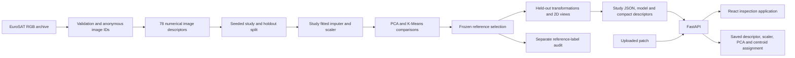
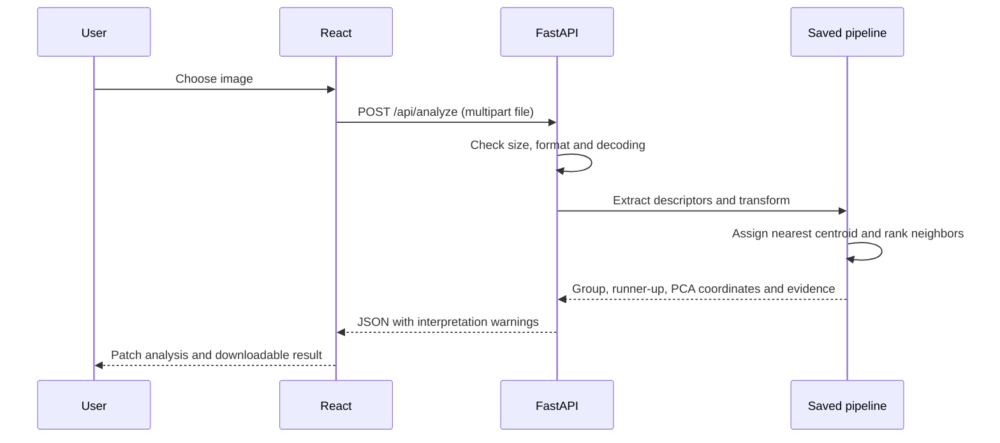

# TerraLens architecture and interfaces

## System boundaries

TerraLens has an offline study pipeline and an online inspection application. The offline pipeline creates an immutable reference study and a fitted model. The application reads those artifacts, performs independent bounded experiments and applies the saved reference pipeline to uploaded images.

The audit branch cannot affect the frozen selection. A seed makes sampling and initialisation traceable, while the archive checksum and package versions identify the input and software. Floating-point results may vary slightly across environments; execution time is hardware dependent.

## Components

| Component | Responsibility | Inputs | Outputs |
|---|---|---|---|
| Dataset preparation | Download, checksum, decode checks, duplicate hashes and anonymous IDs | RGB archive | Valid image inventory and isolated reference metadata |
| Feature extraction | Fixed conversion, resize and deterministic descriptors | Decoded image | 78 finite numerical values |
| Reference study | Study-only fitting, sweeps, sensitivity, heldout and projection evidence | Descriptor matrix and configuration | `study.json`, fitted pipeline and compact numerical bundles |
| Label audit | Evaluate frozen assignments against reference categories | Frozen assignments and isolated labels | Separate `audit.json` |
| API | Validate requests, expose evidence, run bounded jobs and analyse patches | HTTP requests and bundled artifacts | JSON, images and downloadable exports |
| Experiment store | Record request status, configuration and results | Bounded jobs | SQLite rows with configuration/result JSON columns |
| Frontend | Display six connected scientific views | API responses | Linked plots, image inspection and controls |
| Deliverable generator | Produce documents from measured study values | Study, team information, links, real screenshots | Report PDF and editable presentation |

## Data artifacts

`artifacts/study.json` is the public numerical record and includes the dataset audit, feature dictionary, split, PCA variance, candidate runs, selected run, visual cohort, t-SNE comparisons, limitations and provenance. `artifacts/audit.json` is intentionally separate. `artifacts/model.joblib` contains only application-generated trusted objects; uploaded pickle or model files are never accepted. `artifacts/compact_features.npz` enables bounded experiments without shipping the raw dataset. Anonymous thumbnails support the visual inspection.

The raw archive is excluded from the submission package. Full reproduction requires downloading the documented source. The compact bundle supports immediate demonstration but must not be described as a full raw-data reproduction.

## API details

The definitive typed payload contract is `API_CONTRACT.md`. The base path is `/api`.

| Method and route | Purpose |
|---|---|
| `GET /health` | Report service and reference-study readiness |
| `GET /study` | Return the immutable public reference bundle |
| `GET /features` | Return feature names, families and definitions |
| `GET /patches/{id}.jpg` | Return a validated anonymous preview image |
| `GET /audit` | Open the separate post-selection reference-label audit |
| `GET /capabilities` | Advertise actual host limits and storage behaviour |
| `POST /experiments` | Submit bounded K, variance, seed, sample size and optional t-SNE perplexity |
| `GET /experiments` | List recent experiment jobs |
| `GET /experiments/{id}` | Poll status, stage, result or failure |
| `POST /analyze` | Validate an image and apply the saved reference pipeline |
| `GET /export/study.json` | Download the study record |
| `GET /export/metrics.csv` | Download recorded numerical metrics |
| `GET /export/config.json` | Download reproducibility settings |
| `GET /export/experiments/{id}.json` | Download a live job record |

A live experiment accepts K from 2 to 15, PCA retention of 0.90, 0.95 or 0.99, seed from 0 to 9999, and 200 to 3,000 samples subject to the host's advertised cap. Optional t-SNE accepts perplexity 10, 30 or 50 and caps the cohort at 500 or the host limit if lower. Both plots share the same sampled patch IDs. Validation failures should return a clear client error. Failed jobs preserve an error state so the interface can explain what happened. Only one bounded job runs at a time to control memory and CPU use.

## Upload sequence

The scaler and PCA are not refitted on the upload. Distance percentile is an empirical comparison with within-group reference distances, not probability. The upload has a reusable PCA coordinate. Both the recorded and live t-SNE views are fitted on cohorts with fixed membership for the particular run.

## Persistence and deployment

The production backend serves the built frontend and the API from one origin. During development Vite proxies `/api` to FastAPI on port 8000. A local SQLite file records runtime experiment metadata, configuration JSON and result JSON in database columns. Exports are generated when requested. On a free deployment without a persistent disk, these runtime jobs can disappear after a restart. The bundled reference artifacts remain part of the build.

Use host-advertised limits, bounded request sizes and decoded pixel limits. Validate both filename-independent content and image decoding. Uploaded images are not retained after the request; larger multipart inputs may use temporary buffers, which are closed. A single bounded image worker keeps decoding/inference from blocking the request loop. Never execute uploaded files. Model files are loaded only from generated trusted artifact locations. Thumbnails are addressed by anonymous IDs, not user-provided filesystem paths. No account credentials are required by the scientific application.

## Scientific comparisons and metric spaces

Candidate PCA runs report their retained-space internal metrics. A common standardised-original-feature silhouette is recorded where available to improve comparison across retention levels. Inertia from different feature spaces is not directly comparable. t-SNE trustworthiness uses a declared reference space and bounded identical cohort. External metrics belong only to the frozen label audit. Live independent experiments have their own fitted coordinates and cluster numbering.

## Verification responsibilities

- Numerical checks: descriptor length/finiteness, cumulative variance, sample/cluster counts, reproducible IDs, audit isolation, heldout transforms and upload pipeline reuse.
- API checks: health, payloads, bad settings, bad files, bounded jobs and export consistency.
- Interface checks: all six routes, linked patch identity, metric labels, pending/failed/empty states, keyboard focus and responsive overflow.
- Document checks: source/result agreement, actual screenshots, readable page/slide renders, missing identities and unresolved URLs.
- Packaging checks: clean source and dependencies, included compact artifacts, excluded caches/secrets/raw archive and verified execution steps.

## Submission identity and originality

The teacher assigned problem ID `SIH26142`. The submission requires names, registration numbers, actual member contributions and verified links. Disclose AI assistance in accordance with institutional rules. Each member submits identical archive contents under their own `INT396_RegNo.zip` filename.
